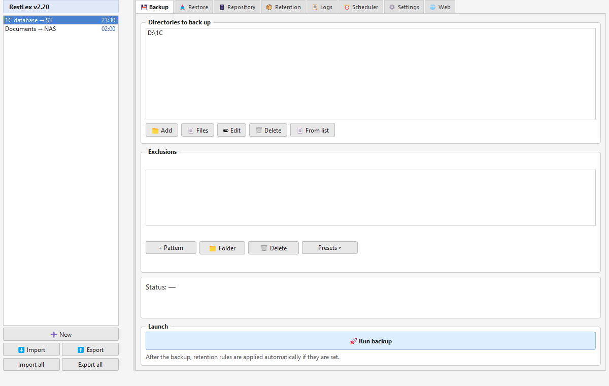
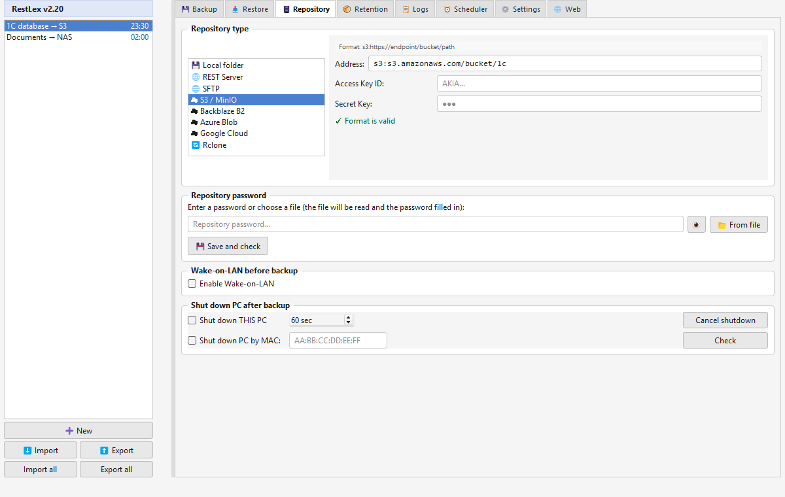
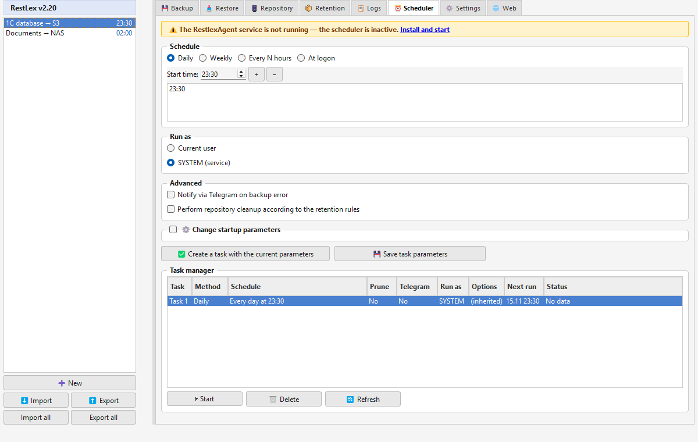
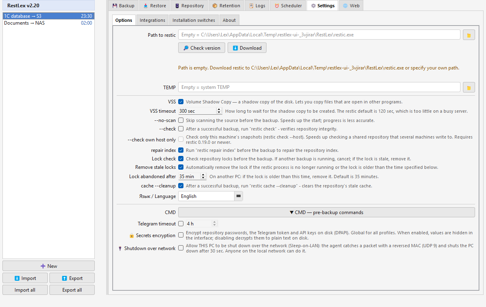
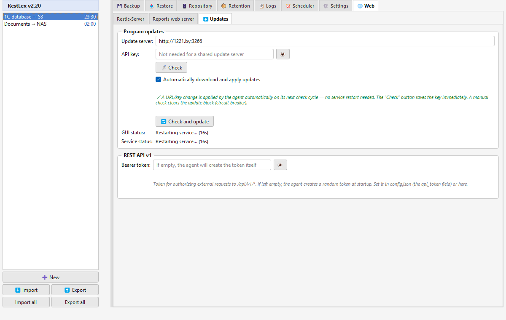
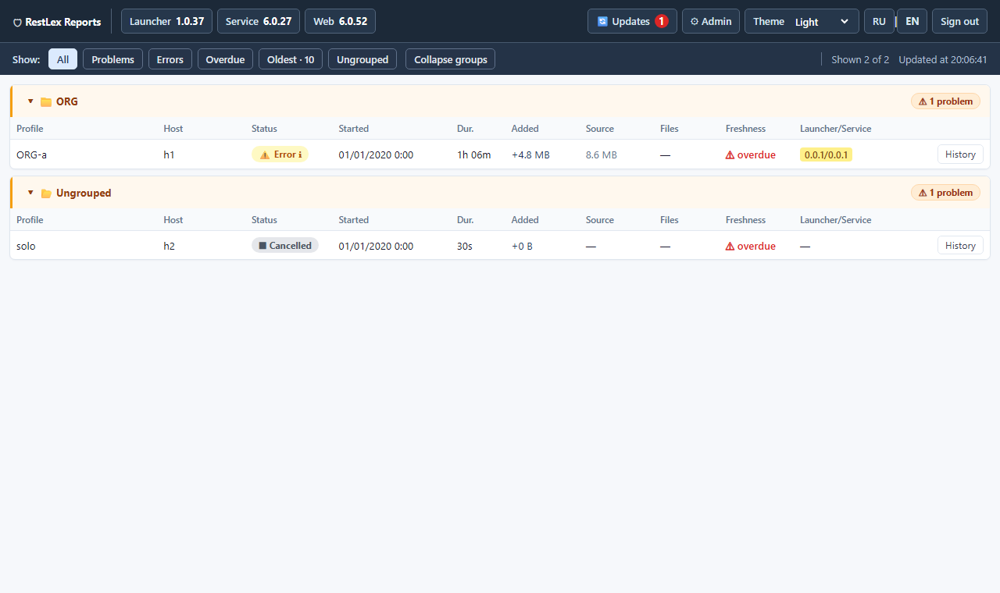
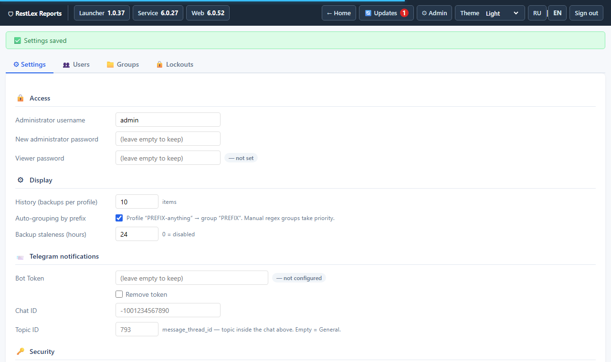

# RestLex

Windows backup manager built on top of [restic](https://restic.net/): a desktop GUI, a background
service that runs schedules, a web dashboard that collects backup reports from many machines,
and an auto-update channel. English and Russian interfaces (picked from the Windows locale on first run).



## Features

- **Backup profiles** — any number, each with its own sources, exclusions, repository and retention policy.
- **Repositories** — local folder / network share, REST Server, SFTP, S3 / MinIO, Backblaze B2, Azure Blob,
  Google Cloud, rclone.
- **Scheduler** — the `RestlexAgent` Windows service runs backups on schedule (daily, weekly, every N hours,
  at logon), retries, VSS snapshots of open files, lock checks.
- **Restore** — browse snapshots, restore single files/folders, find deleted files; mount a repository as a
  read-only network folder (WebDAV).
- **Notifications** — Telegram alerts on failures; reports to the web dashboard.
- **Report web server** (`restlex-webserver`) — dashboard of all machines and profiles, history, machine
  groups, users and roles, stale-backup alerts.
- **Wake-on-LAN / Sleep-on-LAN** — wake the target before a backup and shut it down afterwards.
- **Auto-update** — agent and GUI update themselves from an update server; the agent installs only binaries
  signed by the publisher's certificate.
- **Import / export** of profiles and settings (drag a `.json` export onto the window), CLI for automation.

| | |
|---|---|
|  |  |
|  |  |
|  |  |

## Components

| File | What it is |
|---|---|
| `restlex.exe` | GUI (Python 3 + PyQt5). Windows 10/11, Server 2016+. |
| `restlex-agent.exe` | `RestlexAgent` service: scheduler, watchdog, local REST API, WebDAV mount. Runs on Windows 7 / 2008 R2 and later. |
| `restlex-webserver.exe` | `RestlexWebServer` service: report collector and web dashboard. |
| `restlex-update-server.exe` | `RestlexUpdateServer` service: serves updates to agents and GUIs. |
| `restlex-installer*.exe` | Installers that deploy the agent and pull organisation settings from your update server. |

## Install

Download `RestLex-Setup.exe` from [Releases](../../releases) and run it as administrator. Components:
RestLex (GUI + agent) for machines that are backed up, and the report web server for the machine that
collects reports. See [RestLex-Readme.md](RestLex-Readme.md) for a step-by-step server + client setup
(in Russian).

By default the programs update from the public update server `http://1221.by:3266`. You can point them
to your own `restlex-update-server` in *Web → Updates*.

## Build from source

Requirements: Rust (stable; nightly + `build-std` for the Windows 7 agent target), Python 3.14 with
PyInstaller and PyQt5.

```
cd rust
cargo build --release -p restlex-webserver
cargo build --release -p restlex-update-server
cargo build --release -p restlex-agent
cd ..
pyinstaller restlex.spec --noconfirm
```

or everything at once: `pwsh ./build.ps1 -Components gui,agent,webserver,update-server`.

No keys are stored in the source code. A build of installers with your organisation's settings reads them
from `%USERPROFILE%\.restlex\build-secrets.json` (`update_key`, `install_key`; code signing — `sign_url`,
`sign_token`). Without that file you get a plain public build.

**Self-hosted updates in a fork:** the agent installs updates only from the publisher listed in
`ALLOWED_SIGNER_SERIALS` (`rust/crates/restlex-agent/src/updater.rs`). Put the SERIALNUMBER of your own
code-signing certificate there; unsigned builds are never installed (fail-closed).

## Translations

GUI strings live in `i18n/en.json` (Russian source text → English). After changing UI texts run
`python tools/i18n_extract.py` to list strings and add the missing translations.

## License

[GNU AGPL-3.0](LICENSE). If you run a modified version as a network service (e.g. the report web server),
you must make your changes available to its users.
